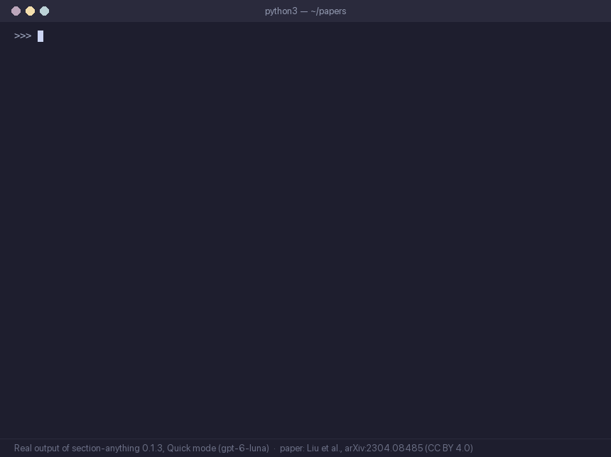

# Section Anything

[](https://pypi.org/project/section-anything/)
[](https://github.com/Omniwot/section-anything/actions/workflows/ci.yml)
[](LICENSE)
[](https://colab.research.google.com/github/Omniwot/section-anything/blob/main/notebooks/quickstart.ipynb)

Find the real sections of a PDF: every heading, its level, the pages it spans and the exact text
under it. Built for RAG pipelines and document tools that need structure, with a dial from free
rules to an LLM that reads the whole document, and a hard cost cap on every paid run.



Real output of section-anything 0.1.0, Quick mode (gpt-6-luna), on *Visual Instruction Tuning*, Liu et al.,
[arXiv:2304.08485](https://arxiv.org/abs/2304.08485), [CC BY 4.0](https://creativecommons.org/licenses/by/4.0/).
Quick mode's output can vary slightly between runs. Try it on that paper in the [Colab notebook](https://colab.research.google.com/github/Omniwot/section-anything/blob/main/notebooks/quickstart.ipynb)
(Free mode, no key needed).

> **Pre-release (0.1).** The API may change before 1.0.

**Website:** https://omniwot.github.io/section-anything/ (how it works, benchmarks, examples)

```python
import section_anything

tree = section_anything.section("paper.pdf", mode="quick")
print(tree.to_markdown())
# # A Study of Sectioning
# ## 1 Introduction
# ### 1.1 Scope
# ## 2 Methods
print(tree.summary())  # mode, model, pages, sections, calls, tokens, cost_usd, seconds
```

## Why

PDF converters guess headings from how a line looks, so paper titles, author names, captions and
theorem statements often come out as sections, and real subsections get the wrong level. Anything
that chunks or navigates by headings inherits those mistakes. Section Anything combines the PDF's
own outline (bookmarks) and printed table of contents, typography and numbering rules, and
optionally a model that reviews or reads the text.

## Results

Heading-tree similarity (TEDS, 0–100, higher is better) on [READoc](https://github.com/icip-cas/READoc)
with READoc's own scoring code, October 2026. Papers not used while developing the method:

| READoc arXiv papers (held out) | Docs | TEDS |
|---|---|---|
| Section Anything `standard` (gpt-6-luna) | 905 | **70.0** |
| Section Anything `quick` (gpt-6-luna) | 905 | 68.0 |
| Section Anything `free` (no model) | 905 | 57.9 |
| Docling 2.140 (heading hierarchy on) | 905 | 49.4 |

`free` and `quick` are release 0.1.2. 0.1.1 found the abstract's heading (journals often set it
small, bold or run into the first line): +2.4 to `free` and +3.7 to `quick` in a pre-registered
held-out test (0.1.0: 54.8 and 63.9). 0.1.2 keeps a section number that the PDF extractor split
off its title ("1" | "Introduction"): +0.7 to `free` (95% CI +0.5 to +1.0) and +0.5 to `quick`
(95% CI +0.4 to +0.8; +1.7 on the 291 papers it changes) in a second pre-registered test (0.1.1:
57.2 and 67.4).
`standard` uses neither. See the [changelog](CHANGELOG.md).

On the same 905 papers with MinerU's cloud: our `standard` 70.0, our `quick` 68.0, MinerU + its own
LLM title levels (gpt-6.1-sol) 64.8 (`standard` +5.1, 95% CI +4.0 to +6.2, or +2.8 without the 154
papers where its LLM step gave up and kept its raw levels; `quick` +3.1, 95% CI +2.1 to +4.1, but
level without those papers: +1.0, 95% CI −0.03 to +2.0),
MinerU alone 53.9, Docling 49.4.

On GitHub READMEs, `free` leads: on 1,112 bookmarked READMEs not used in development it scores
81.9 against Docling's 75.5 (79.7 with the change we proposed upstream,
[docling#5002](https://github.com/docling-project/docling/issues/5002)).
On 27 UK government reports never used in development (answer keys from each report's HTML
version), the outline check improved `free` by +5.7 (95% CI +0.4 to +12.2; 43.1 → 48.8; measured on 0.1.0).

**Where others win:** on READMEs our `quick` and `standard` only tie with Docling (about 75). Nougat,
an OCR model trained on arXiv, scores far higher on arXiv papers (88.5, published). Better headings improved RAG retrieval in our
[Qasper test](docs/rag-qasper.md) but not answer quality.

## Settings and cost

| Mode | What runs | Sent to a model | Cost per 1,000 pages |
|---|---|---|---|
| `free` (default) | bookmarks or the printed contents as the outline, then typography and numbering rules; headings a complete-looking outline does not list are dropped | nothing | $0 |
| `quick` | rules propose candidate heading lines; a small model keeps the real ones and sets levels | candidate lines only | about $0.07 (gpt-6-luna) |
| `standard` | a model reads every line, with font hints, and marks where sections start and end | the document text | about $0.16 (gpt-6-luna) to $2.90 (gpt-6.1-sol) |
| `local:<model>` | `quick`, answered by a local Ollama model | nothing leaves the machine | $0 |

Every paid run is estimated first and capped (default $0.50 per document); over the cap it
downgrades (standard → quick → free) or fails, as you choose.

## Install

Python 3.11 or newer:

```sh
pip install section-anything
pip install "section-anything[langfuse]"  # optional Langfuse tracing
# latest from GitHub:
pip install "git+https://github.com/Omniwot/section-anything#subdirectory=packages/section-anything"
```

Command line:

```sh
section-anything paper.pdf                                # free, Markdown headings
section-anything paper.pdf --mode quick --format json     # JSON with spans and cost
section-anything paper.pdf --mode standard --max-usd 0.5  # cap this document at $0.50
```

API keys come from the environment only (`SECTIONANY_API_KEY`, or `OPENAI_API_KEY` for OpenAI's
endpoint); any OpenAI-compatible endpoint works. Full options, output format and the security
model for untrusted PDFs: [packages/section-anything/README.md](packages/section-anything/README.md).

## Integrations

One document per section, with the heading path, pages and character span as metadata. Each
package depends only on `section-anything` and the framework's core package.

```sh
pip install langchain-section-anything
pip install llama-index-readers-section-anything
pip install lightrag-section-anything
```

| Framework | Package | Use |
|---|---|---|
| LangChain | [`langchain-section-anything`](packages/langchain-section-anything) | `SectionAnythingLoader("paper.pdf", mode="free").load()` |
| LlamaIndex | [`llama-index-readers-section-anything`](packages/llama-index-readers-section-anything) | `SectionAnythingReader(mode="free").load_data("paper.pdf")`, or as the `.pdf` reader of `SimpleDirectoryReader` |
| LightRAG | [`lightrag-section-anything`](packages/lightrag-section-anything) | parser engines (`sectionany_free`, `sectionany_quick`, ...) for LightRAG's heading-based chunker, without a MinerU or Docling service |

## Limitations

- Reads the PDF's text layer; scanned PDFs need OCR first.
- Tables, figures and equations are not structured; their text stays in the section text.
- `free` is best when the PDF has bookmarks or a printed table of contents. When the bookmarks look
  complete, it drops headings they do not list; if the bookmarks stop at the top levels, real deeper
  headings are lost (about 6% of READMEs lose more than 5 points). Turn this off with
  `SECTIONANY_DEMOTE_UNLISTED_HEADINGS='[]'`.
- `quick` and `standard` send text to the provider you configure.

## Repository

| Path | What it is |
|---|---|
| `packages/section-anything/` | the library and CLI (Apache-2.0) |
| `packages/langchain-section-anything/` | LangChain document loader |
| `packages/llama-index-readers-section-anything/` | LlamaIndex reader |
| `packages/lightrag-section-anything/` | LightRAG parser plugin |
| `backend/`, `frontend/` | a demo web app: upload a PDF, see the sections highlighted ([docs/app.md](docs/app.md)) |
| `site/` | project website and benchmark tables (`site/data/results.js`) |
| `corpus/` | our test corpus: answer keys, results and the tools that rebuild it (no PDFs stored) |
| `docs/` | write-ups: [RAG on Qasper](docs/rag-qasper.md), [the Docling contribution](docs/docling-pr/), plans and a paper draft |

## Data and credits

- Benchmarks use [READoc](https://arxiv.org/abs/2409.05137) (dataset MIT,
  [Hugging Face](https://huggingface.co/datasets/lazyc/READoc)) with READoc's own scoring code,
  which is not included here.
- Unseen-document checks use [HiPS](https://arxiv.org/abs/2509.00909) law-book annotations
  (CC BY-NC 4.0), UK government reports (Open Government Licence v3) and Canadian federal acts
  (Justice Laws website).
- Every corpus source and its licence: [`corpus/DATA-LICENSES.md`](corpus/DATA-LICENSES.md).
- To cite this project, see [`CITATION.cff`](CITATION.cff).

## Licence

Code: Apache-2.0 (`LICENSE`, `NOTICE`). The data under `corpus/` keeps its sources' licences: see
[`corpus/DATA-LICENSES.md`](corpus/DATA-LICENSES.md).
